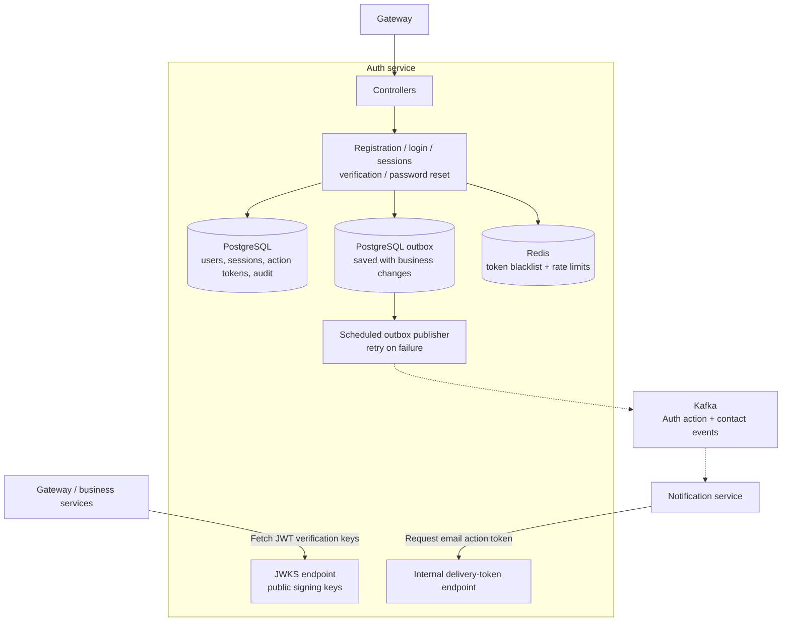

# Auth Service visual map

Boxes inside the boundary are internal components; cylinders are storage. Dashed arrows carry asynchronous events.

Redis is a separate dependency for revocation and abuse protection. Email events flow through the database outbox, publisher, Kafka, and Notification. Notification obtains usable action tokens through the protected internal endpoint immediately before delivery.

Source: [AuthOutboxPublisher](../src/main/java/com/ecommerce/auth/messaging/AuthOutboxPublisher.java), [AuthAbuseProtection](../src/main/java/com/ecommerce/auth/service/AuthAbuseProtection.java), [TokenBlacklistService](../src/main/java/com/ecommerce/auth/service/TokenBlacklistService.java).

See [high-level design](hld.md) and [events and operations](events-and-operations.md) for contracts and recovery details.
