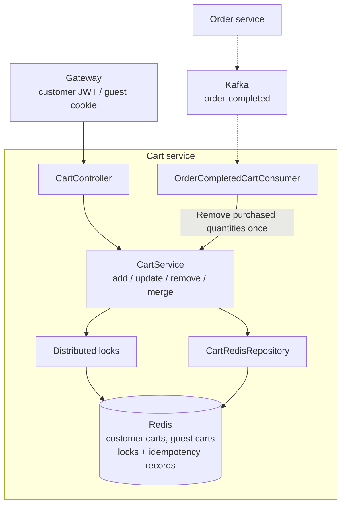

# Cart Service visual map

Boxes inside the boundary are internal components; cylinders are storage. Dashed arrows carry asynchronous events.

Redis stores cart composition. Order Service validates product, price, and stock during checkout. The Kafka consumer removes only purchased quantities after payment confirmation; duplicate event IDs do not remove them twice.

Source: [CartService](../src/main/java/com/ecommerce/cart/service/CartService.java), [CartRedisRepository](../src/main/java/com/ecommerce/cart/repository/CartRedisRepository.java), [OrderCompletedCartConsumer](../src/main/java/com/ecommerce/cart/kafka/OrderCompletedCartConsumer.java).

See [events and operations](events-and-operations.md) for the cart lifecycle policy.
