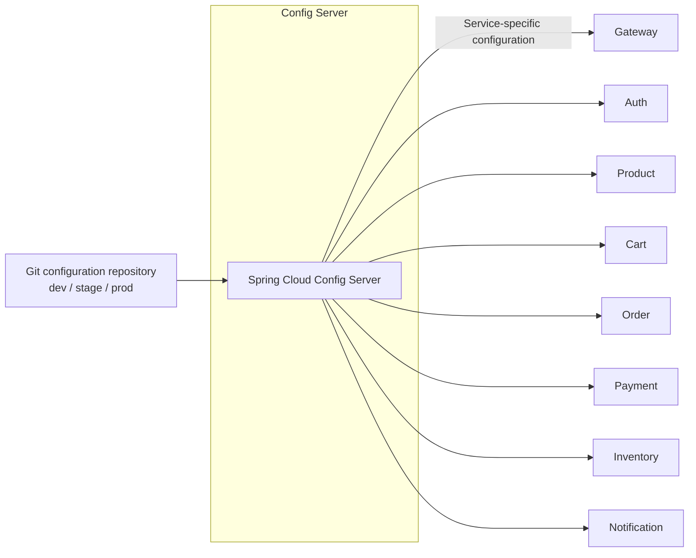

# Config Server visual map

Arrows show configuration flowing from the Git repository to consuming services. Services request their application/profile configuration from Config Server over HTTP.

The configured Git backend uses the `main` label and profile-specific search paths. Services select the server through `CONFIG_SERVER_URL`; local imports can be optional. Configuration delivery is separate from business requests and Kafka events, and secrets remain deployment-owned.

Source: [application configuration](../src/main/resources/application.yml).

See [high-level design](hld.md) and [events and operations](events-and-operations.md) for configuration behavior.
