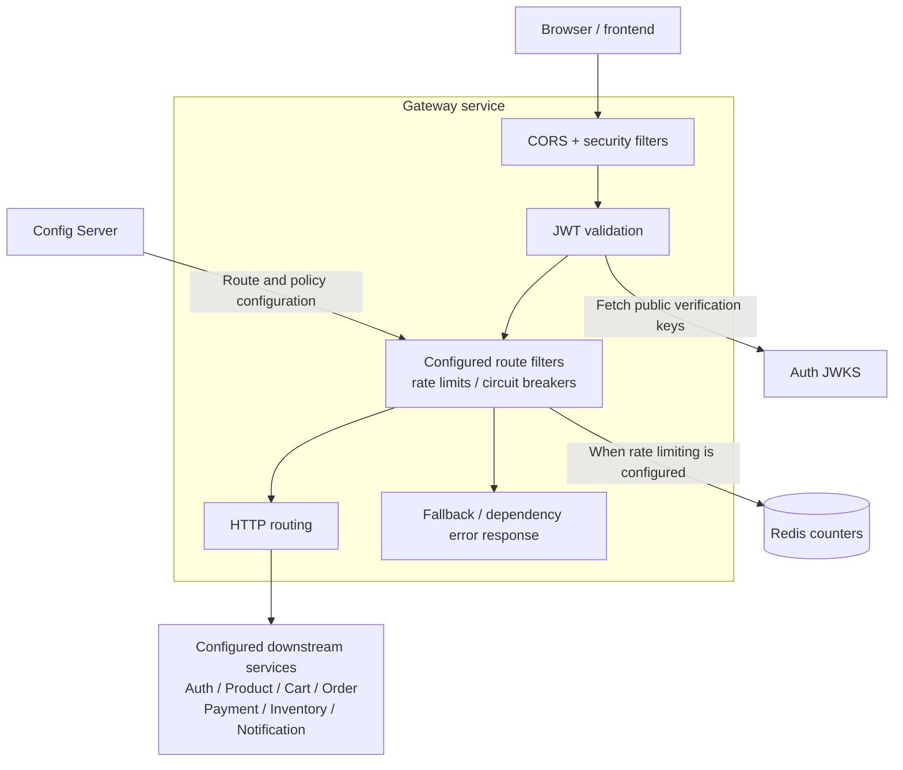

# Gateway Service visual map

Boxes inside the boundary are internal components; cylinders are storage. Arrows show request or configuration dependencies, not a strict filter execution order.

Route definitions come from external configuration; enabled routes and filters depend on the deployed profile. Public routes can allow anonymous requests. Gateway owns no business database or Kafka workflow, and downstream services enforce their own authorization.

Source: [SecurityConfig](../src/main/java/com/ecommerce/gateway/config/SecurityConfig.java), [GatewayJwtDecoderConfig](../src/main/java/com/ecommerce/gateway/config/GatewayJwtDecoderConfig.java), [GatewayRateLimitConfig](../src/main/java/com/ecommerce/gateway/config/GatewayRateLimitConfig.java), [application configuration](../src/main/resources/application.yml).

See [high-level design](hld.md) and [events and operations](events-and-operations.md) for deployment and routing details.
