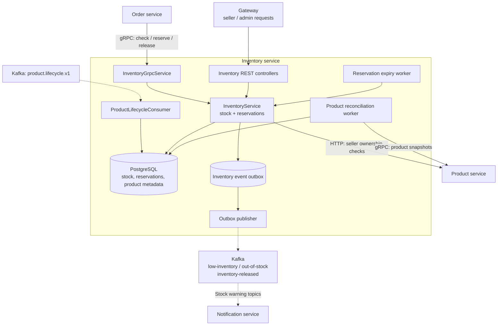

# Inventory Service visual map

Boxes inside the boundary are internal components; cylinders are storage. Dashed arrows carry asynchronous events.

Product lifecycle events and reconciliation update product metadata while preserving stock counters. Reservation expiry and stock warnings use the PostgreSQL event outbox. Notification consumes the stock warning topics. The legacy `product-created` consumer remains for rolling-upgrade compatibility; the map shows the primary lifecycle path.

Source: [InventoryService](../src/main/java/com/ecommerce/inventory/service/InventoryService.java), [InventoryEventPublisher](../src/main/java/com/ecommerce/inventory/service/InventoryEventPublisher.java), [InventoryReconciliationWorker](../src/main/java/com/ecommerce/inventory/service/InventoryReconciliationWorker.java).

See [high-level design](hld.md) and [events and operations](events-and-operations.md) for reservation and recovery details.
