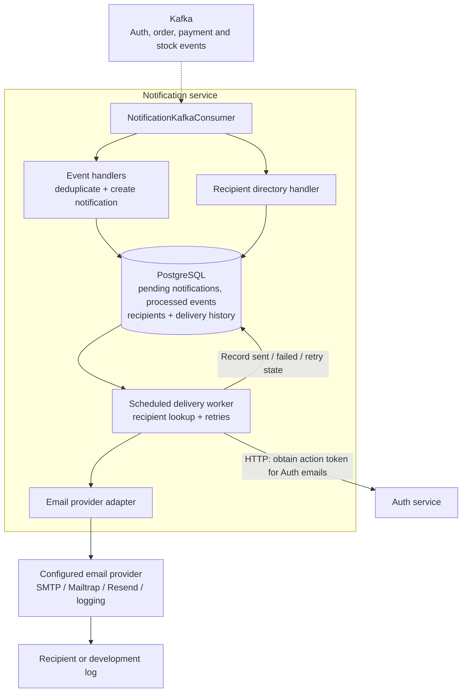

# Notification Service visual map

Boxes inside the boundary are internal components; cylinders are storage. Dashed arrows carry asynchronous events.

Kafka handling persists notification work before scheduled delivery. Auth action tokens are obtained immediately before sending and are not retained in notification payload storage. Order confirmation email comes from `order-completed`, after Order confirms payment. The selected provider controls whether delivery sends email or writes a development log.

Source: [NotificationKafkaConsumer](../src/main/java/com/ecommerce/notification/kafka/NotificationKafkaConsumer.java), [NotificationDeliveryService](../src/main/java/com/ecommerce/notification/service/NotificationDeliveryService.java).

See [high-level design](hld.md) and [events and operations](events-and-operations.md) for topics and retry behavior.
