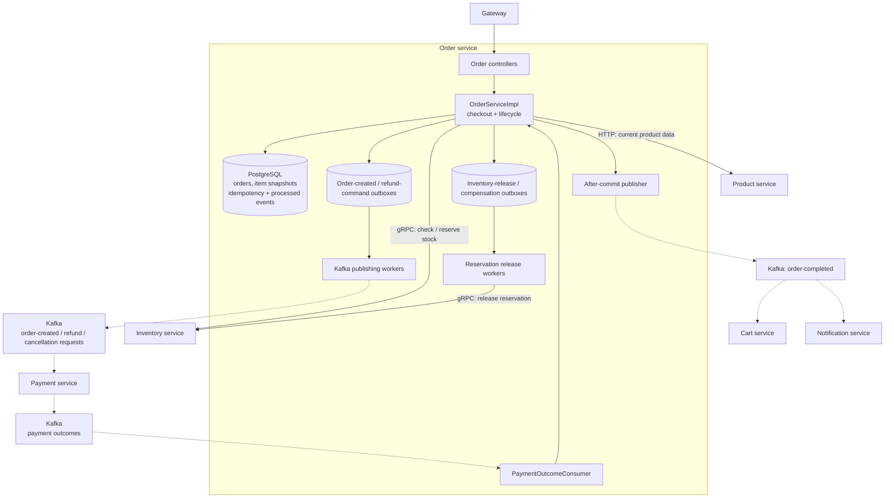

# Order Service visual map

Boxes inside the boundary are internal components; cylinders are storage. Dashed arrows carry asynchronous events.

The outboxes are PostgreSQL tables. Order-created and refund/cancellation commands use durable publishing workers. Inventory release and checkout compensation workers call Inventory directly through gRPC.

In the current implementation, `order-completed` uses an after-commit Kafka send rather than a durable outbox. It is emitted when payment success moves a pending order to confirmed, and triggers cart cleanup and confirmation email.

Source: [OrderServiceImpl](../src/main/java/com/ecommerce/order/service/OrderServiceImpl.java), [OrderEventPublisher](../src/main/java/com/ecommerce/order/kafka/OrderEventPublisher.java), [PaymentOutcomeConsumer](../src/main/java/com/ecommerce/order/kafka/PaymentOutcomeConsumer.java).

See [high-level design](hld.md) and [events and operations](events-and-operations.md) for lifecycle and worker details.
