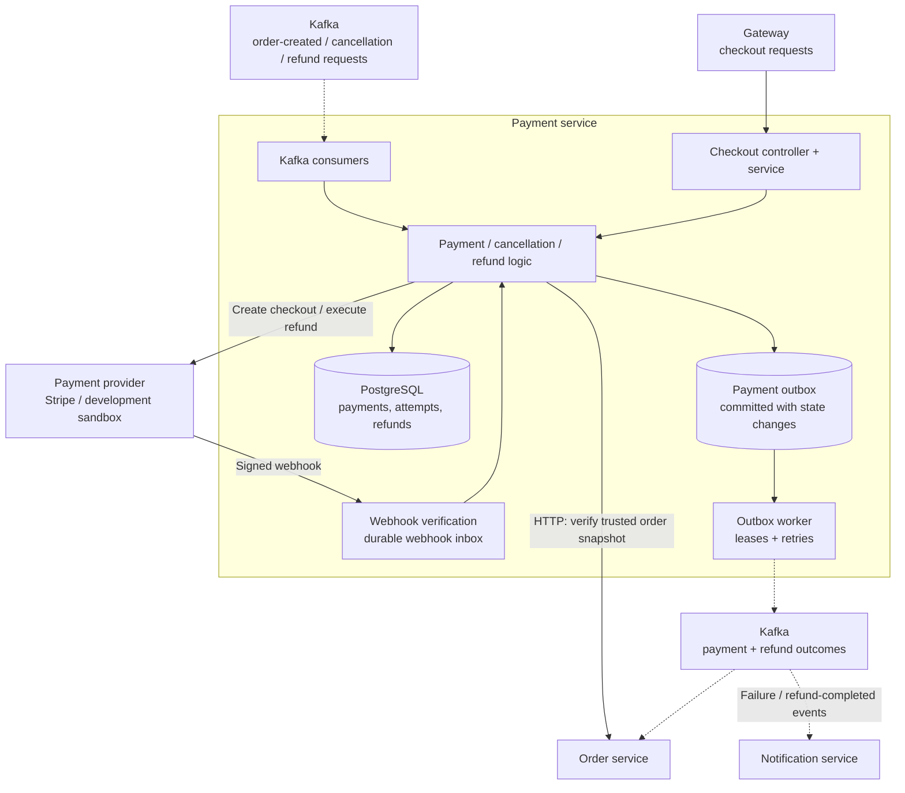

# Payment Service visual map

Boxes inside the boundary are internal components; cylinders are storage. Dashed arrows carry asynchronous events.

Payment validates the trusted Order snapshot before preparation. Verified provider webhooks drive payment confirmation; browser redirects only read state. Payment/refund changes and their outbox events commit together in PostgreSQL. Provider selection and enablement depend on deployment configuration.

Source: [TrustedOrderClient](../src/main/java/com/ecommerce/payment/order/TrustedOrderClient.java), [KafkaPaymentEventPublisher](../src/main/java/com/ecommerce/payment/kafka/producer/KafkaPaymentEventPublisher.java), [PaymentOutboxWorker](../src/main/java/com/ecommerce/payment/outbox/PaymentOutboxWorker.java).

See [high-level design](hld.md) and [production reliability](production-reliability.md) for provider and recovery details.
