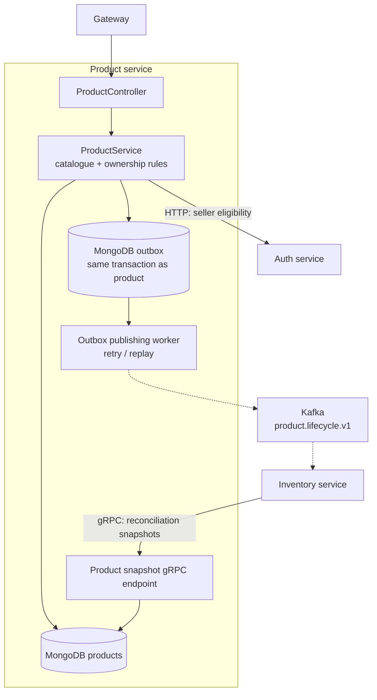

# Product Service visual map

Boxes inside the boundary are internal components; cylinders are storage. Dashed arrows carry asynchronous events.

Product and lifecycle event persistence share a MongoDB transaction. Inventory consumes versioned snapshots without resetting stock, and can recover missing metadata through the snapshot gRPC endpoint.

Source: [ProductService](../src/main/java/com/ecommerce/product/service/ProductService.java), [ProductOutboxService](../src/main/java/com/ecommerce/product/outbox/ProductOutboxService.java), [ProductSnapshotGrpcService](../src/main/java/com/ecommerce/product/grpc/ProductSnapshotGrpcService.java).

See [high-level design](hld.md) and [lifecycle operations](lifecycle-operations.md) for contracts and recovery details.
